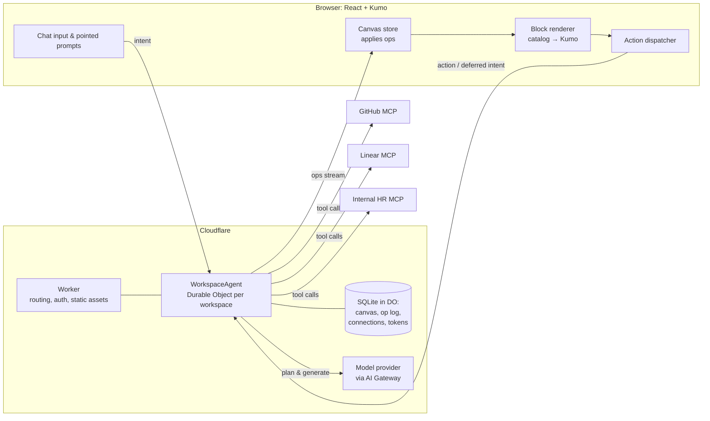

# RFC 0001: Intent-Driven Continuous Generative UI

| | |
|---|---|
| **Status** | Draft |
| **Author** | Brayden Wilmoth |
| **Created** | 2026-11-06 |
| **Last updated** | 2026-11-06 (linked ADR 0001) |

> This is the founding RFC for Intent UI. It defines the product, the core model, and the
> plan for building it. Later RFCs and ADRs refine pieces of it; when one does, link it from
> [§13 Related documents](#13-related-documents).

---

## 1. Summary

Intent UI is an application that builds itself while you use it. A user opens a page and
types what they want ("Show me all the members of my team"). The system calls the right
tools on the user's connected data sources, then generates a UI made of Kumo components
that shows the result. Every control in that UI can carry an **unbuilt intent**: when the
user clicks it, the UI it needs (a modal, a form, a toast) is generated at that moment, not
in advance. A ⌘K command menu is always one keystroke away ([ADR 0010](../decisions/0010-command-menu-is-the-only-chrome.md)), and users can right-click any element to give
it a pointed instruction. New requests **amend** the existing UI wherever that makes more
sense than adding something new.

The result is a full application assembled continuously from the user's own data sources,
with no separate "build it" and "use it" phases.

## 2. Motivation

Generative UI today is mostly one-shot: a prompt produces a screen, and the user either
uses it as-is or asks for a whole new one. Real applications don't work that way. They're
made of many small, connected interactions, most of which a user never touches. Generating
all of them up front is slow, expensive, and mostly wasted.

At the same time, the data a person works with is spread across many systems (GitHub,
Linear, Cloudflare, internal HR tools), increasingly reachable through MCP. Every user has a
different mix, so no fixed application serves everyone well.

Intent UI treats the interface as something that grows from the user's intents: generate
only what's needed, exactly when it's needed, from whatever sources that user has connected,
and keep what's been built so it's instant the next time.

## 3. Goals and non-goals

### Goals

1. **Prompt to working UI.** Natural-language input produces interactive UI backed by live
   data from the user's connected sources.
2. **Lazy, continuous generation.** Interactions that haven't been built yet are generated
   on first use, then kept and reused.
3. **Amend over append.** New requests modify existing UI (add a column, change a format)
   when that fits better than creating a new block. Elements can also be removed.
4. **Pointed edits.** Right-clicking an element scopes a prompt to that element.
5. **Pluggable data sources.** Users add and remove their own connections: remote MCP
   servers first, WebMCP and others later.
6. **One design language.** All generated UI uses the Kumo component library, so everything
   looks and behaves consistently, in light and dark mode.
7. **Safe by construction.** The model never ships executable code to the client. It emits
   declarative specs validated against a known catalog.

### Non-goals (for now)

- Generating arbitrary React/HTML/JS code.
- Exporting a generated workspace as a standalone codebase.
- Real-time multi-user collaboration on one workspace (designed not to preclude it).
- Building our own data connectors: we consume MCP servers; we don't write them.
- Mobile-native clients.

## 4. User experience

### 4.1 The core loop

```
 type an intent ──► tools are called ──► UI block streams in
        ▲                                        │
        │                                        ▼
 chat / right-click ◄── UI is amended ◄── user interacts with an unbuilt control
                                                 │
                                                 ▼
                                    the missing UI is generated on demand
```

### 4.2 Walkthrough

1. **Ask.** The user types "Show me all the members of my team." The system finds an
   employee-directory tool on a connected internal MCP server, calls it, and streams in a
   **Table** block: name, title, email, and a final column with a `⋯` menu.
2. **Explore unbuilt actions.** The menu lists *Edit*, *View profile*, and *Remove from
   team*. None of these have UI yet; they're **deferred intents**.
3. **Materialize on click.** The user clicks *Edit* on one row. A **Dialog** with fields for
   name and job title is generated, pre-filled from that row, and opens. The generated dialog
   is saved as a template bound to "a row of this table", so clicking *Edit* on any other row
   opens it instantly with no generation.
4. **Act.** The user clicks *Save*. The dialog's action calls the directory's update tool
   (after a confirmation, since it's a write). The outcome (a success **Toast** or an inline
   error) is also a deferred intent, generated the first time it's needed.
5. **Amend.** The user types "Show me open pull requests for each team member." Instead of a
   new block, the system **adds a column** to the existing table, backed by a GitHub MCP
   query per member, with each cell linking to that member's open PRs.
6. **Point.** The user right-clicks the PR column and types "Show these as opened today /
   merged today / closed today." Only that column is regenerated.
7. **Remove.** "Hide the email column" removes that column. Removal is an amend like any other.

### 4.3 Interaction surfaces

| Surface | Behavior |
|---|---|
| **Chat input** | Always visible, docked at the bottom. Scope defaults to the whole workspace. |
| **Right-click / pointed prompt** | Context menu on any generated element → "Change this…" opens an inline prompt scoped to that element and its subtree. |
| **Deferred controls** | Look identical to built controls. On first activation show an inline loading state, then the generated result. |
| **Activity / history** | A collapsible panel listing every change (who/what/when), with undo. |
| **Connections** | A settings surface to add, authenticate, and remove data sources. |

### 4.4 Latency expectations

| Moment | Target (p50) | How |
|---|---|---|
| First visible feedback after a prompt | < 300 ms | Optimistic skeleton block, streamed plan |
| First streamed UI element | < 1.5 s | Stream elements as they're generated |
| Materializing a deferred intent | < 2 s | Small, scoped generation; stream; prefetch likely ones (later) |
| Re-using a materialized intent | < 100 ms | Pure client-side render from stored template |

## 5. Concepts and glossary

| Term | Meaning |
|---|---|
| **Workspace** | One user's continuously built application: its canvas, connections, history. |
| **Canvas** | The ordered set of blocks currently in a workspace. |
| **Block** | A top-level unit of UI (a table, a chart, a card group) with its own UI tree, data, and provenance. Overlays (dialogs, toasts) are blocks too, anchored to a parent. |
| **UI tree** | A block's components, as Kumo's flat `UITree` (`root` + `elements` keyed by id). |
| **Element** | One node in a UI tree: a Kumo component type, props, children, optional visibility and action. |
| **Catalog** | The allowlist of components and actions the model may use, derived from Kumo's registry plus our own composite components. |
| **Connection** | A configured data source (an MCP server, later WebMCP, etc.) with its auth and tools. |
| **Query** | A declarative, re-runnable tool call that feeds a block's data model. |
| **Data model** | The JSON a block's dynamic props read from via JSON Pointer paths (`{ "path": "/members/0/name" }`). |
| **Intent** | A natural-language request plus its scope (workspace, block, or element) and context. |
| **Deferred intent** | An action attached to a control whose UI has not been generated yet. |
| **Materialization** | Generating the UI for a deferred intent on first use, then storing it as a reusable template. |
| **Op** | One atomic change to the canvas (add/update/remove an element, set a query, etc.). All changes are ops. |

## 6. Architecture overview



**Key choices** (each becomes an ADR when we commit to it):

- **One `WorkspaceAgent` Durable Object per workspace**, built on the Cloudflare
  [Agents SDK](https://developers.cloudflare.com/agents/). It owns the canvas, op log, chat
  history, and connections, and talks to the client over a WebSocket. The SDK's MCP client
  (`addMcpServer`, OAuth, `listTools`, `getAITools`) handles connections, and persists
  registrations and tokens in the DO's SQLite.
- **The server is the source of truth for the canvas.** The client applies the op stream and
  renders. This makes persistence, history, multi-device, and later collaboration simpler.
- **Tools run server-side** (inside the agent), except browser-only sources like WebMCP,
  which the client executes and reports back (see §9).
- **Model access goes through AI Gateway**, so we can switch providers and models per task
  (planning vs. generation) and get caching, logs, and rate limiting.

## 7. The UI specification

### 7.1 Building on Kumo's catalog

Kumo already ships what we need for a declarative, LLM-friendly UI format in
`@cloudflare/kumo/catalog`:

- A **flat `UITree`** (`root` + `elements` keyed by id, each with `children` keys). Flat
  trees stream well and make targeted edits trivial: amending an element is replacing one
  key.
- **Dynamic values** bound to a data model by JSON Pointer (`{ "path": "/user/name" }`).
- **Visibility conditions** (`and`/`or`/`not`/`eq`/`gt`/…) evaluated against the data model.
- **Actions** with `name`, `params`, an optional `confirm` dialog, and `onSuccess`/`onError`.
- **Generated zod schemas** for every component's props, `validateTree`, and
  `generatePrompt()` to describe the catalog to a model.

We adopt this format as-is for each block's UI tree, so validation and component prop
schemas come from Kumo and stay in sync with the library version we install. Kumo doesn't
provide a renderer for it, so we write one (a map from catalog type → Kumo component, plus
dynamic-value resolution and action wiring).

One gap: the catalog lists top-level components only (`Dialog`, `DropdownMenu`, `Table`),
not their compound parts (`DropdownMenu.Item`, `Table.Row`). Compound components therefore
need our own flat catalog entries or composites (§7.4) that the renderer expands into the
right Kumo parts.

### 7.2 What we add on top

Kumo's format describes one tree. Intent UI adds a layer around it:

```ts
// Illustrative shapes, not final.
type Block = {
  id: string;
  kind: "inline" | "overlay";       // overlay = dialog/drawer/toast anchored to a parent
  anchor?: { blockId: string; elementKey?: string };
  tree: UITree;                      // Kumo's flat tree
  queries: Record<string, Query>;    // feed the data model
  data: DataModel;                   // last resolved query results + local state
  templates: Record<string, Template>; // materialized deferred intents (see §8)
  provenance: Provenance[];          // which intents/ops shaped this block
};

type Query = {
  connectionId: string;
  tool: string;                      // MCP tool name
  args: Record<string, DynamicValue>; // may reference the data model or row scope
  target: string;                    // JSON Pointer in the data model to write results to
  select?: Mapping;                  // declarative reshape of the tool result (see §7.3)
  refresh?: "manual" | { everySeconds: number } | "onFocus";
  forEach?: string;                  // run once per item at this path (e.g. PRs per member)
};
```

### 7.3 Data mapping

> Reproducibility rules for queries, mappings, item keys, joins, and snapshots are settled
> in [ADR 0001](../decisions/0001-spec-is-source-of-truth.md). The choice of mapping
> language below is still open.

Tool results rarely match what a component needs. The model needs a way to reshape them,
but we will not run model-written JavaScript. Options, to be settled in an ADR:

1. A **restricted mapping language** such as JSONata or JMESPath, evaluated in a sandbox.
2. A **small built-in set** of declarative transforms (`pick`, `rename`, `map`, `filter`,
   `groupBy`, `count`, `format`), extended as needed.

Starting position: option 2, since it's easy to validate and explain, with option 1 as an
escape hatch if the transform set grows unwieldy.

### 7.4 Composite components

Some patterns are too repetitive or fiddly to rebuild from primitives each time. We add a
small number of **composite catalog entries** that wrap Kumo components with data-aware
behavior, for example:

- `DataTable`: binds to an array path; declares columns (each column is its own element
  subtree with row scope), sorting, pagination, and a row-actions column. Columns are
  first-class, so "add a PR column" is a single op.
- `RecordForm`: generates fields from a JSON Schema (often the input schema of an MCP
  tool), with validation, and submits via an action.
- `StatGroup`: a row of stat tiles bound to numeric paths.
- `ActionMenu` / `MenuItem`: a flattened `DropdownMenu` whose items are elements, each with
  its own action (often a deferred intent).

Composites are added only when a pattern recurs, and each one is documented in the catalog
prompt like any Kumo component.

### 7.5 Row and item scope

Elements inside repeated contexts (table rows, list items) resolve paths relative to the
current item with a `$item` prefix (e.g. `{ "path": "$item/login" }`). This is how a
materialized dialog can be reused for every row: its template references `$item`, and the
clicked row supplies it.

## 8. Continuous generation

### 8.1 Ops

Every change to a workspace is an **op**. The model never rewrites a whole canvas; it emits
ops through tool calls, and the agent validates and applies them, persists them to the op log,
and streams them to the client.

| Op | Effect |
|---|---|
| `block.create` | Add a block (inline or overlay) at a position. |
| `block.remove` | Remove a block and its overlays. |
| `element.upsert` | Add or replace one element (validated against the catalog). |
| `element.remove` | Remove an element and its subtree. |
| `element.move` | Re-parent or reorder an element. |
| `query.set` / `query.remove` | Add, change, or drop a query; triggers a (re)fetch. |
| `template.set` | Store a materialized deferred intent. |
| `data.set` | Set local UI state (selection, form values, open/closed). |

Because ops are small and keyed by id, they stream naturally: the client renders each
element as it arrives, and skeletons fill gaps. The op log gives us history, undo, and
replay for free.

### 8.2 Deciding to amend, append, or remove

Every intent goes through a **planning step** before generation:

1. **Context:** the prompt, its scope (workspace / block / element from a right-click), a
   compact **canvas summary** (blocks, their purpose, columns/fields, queries, and the tools
   behind them; never the raw data), and the available tools.
2. **Plan:** the planner returns a structured decision: `amend` (with target ids),
   `append`, `remove`, `clarify` (ask the user a question), or `none` (e.g. purely
   informational, answered in chat).
3. **Generate:** a focused generation pass emits ops only for the targets in the plan.

Heuristics for the planner (also encoded in the prompt and in eval cases):

- New data **about the same entities** shown in a block → amend (add a column, field, or
  badge). *"PRs per team member"* → new column on the team table.
- A **different entity** or a **different view** of the same data → append. *"Show me the
  Linear issues for the platform project"* → new block.
- A **pointed prompt** → amend that element only, unless the instruction clearly requires
  structural change to its parent.
- **Ambiguity with destructive consequences** → `clarify` rather than guess.

Splitting planning from generation keeps each model call small, makes the decision
inspectable and testable, and lets us use a faster model for planning.

### 8.3 Deferred intents and materialization

Any action may be a **deferred intent**: a description of what should happen, without the
UI for it.

```jsonc
{
  "key": "row-menu-edit",
  "type": "MenuItem",
  "props": { "children": "Edit" },
  "action": {
    "name": "intent",
    "params": {
      "id": "edit-team-member",
      "prompt": "Edit this team member's name and job title",
      "item": { "path": "$item" }
    }
  }
}
```

On activation:

1. The client checks the block's `templates` for `edit-team-member`. **If present, render it
   immediately** with the current `$item`. Done.
2. Otherwise, the client shows a loading state on the control and sends the intent, its
   scope, and the item to the agent.
3. The agent runs a **scoped generation**: the prompt, the item's shape (not necessarily
   its values), the parent block summary, and the relevant tools (e.g. the directory's
   update tool and its input schema).
4. The result is a `template.set` op (stored on the block) plus a `block.create` for the
   overlay, which opens with the clicked item.

Templates are **parameterized by scope**, not by specific data, so one generation serves
every row. When the underlying tool or block shape changes, affected templates are marked
stale and regenerated on next use.

**Reuse across intents.** Templates are kept in a workspace-level library and an intent is
matched against existing templates before anything new is generated, so differently worded
requests for the same UI converge on one template. See
[ADR 0003](../decisions/0003-template-library-and-reuse.md).

**Outcome intents.** `onSuccess` / `onError` may also be deferred intents (e.g. "confirm
the change"), materialized into a toast or an inline banner on first occurrence.

**Prefetching (later).** Once the core loop is fast enough, the agent may speculatively
materialize the most likely next intents in the background during idle time.

### 8.4 Actions

The client knows a small, fixed set of action names. Everything else is expressed through
them:

| Action | Behavior |
|---|---|
| `intent` | Materialize-or-render a deferred intent (above). |
| `tool` | Call a connection's tool with resolved params; writes always confirm first (§10). |
| `set` | Update local UI state in the data model. |
| `open` / `close` | Show or dismiss an overlay block. |
| `refresh` | Re-run a block's queries. |
| `navigate` | Open an external link (new tab). |

## 9. Data sources (connections)

### 9.1 Connection model

```ts
type Connection = {
  id: string;
  kind: "mcp" | "webmcp" /* later: "openapi" */;
  name: string;                 // "GitHub", "Acme HR"
  status: "ready" | "authenticating" | "error" | "disabled";
  tools: ToolInfo[];            // name, description, input schema, read/write hint
  policy: { writes: "confirm" | "deny" };
};
```

### 9.2 Remote MCP servers (first)

- Added by URL from the Connections surface. The agent calls `addMcpServer`; if the server
  needs OAuth, the user is redirected to authorize, then returns.
- Tokens and registrations are stored in the workspace agent's SQLite and restored on wake.
- The agent refreshes each server's tool list on connect and when the server signals changes.
- Tool names are namespaced by connection to avoid collisions.

### 9.3 Tool selection at scale

Users may connect many servers with hundreds of tools. Passing every tool to every model
call doesn't scale. The planner gets a **tool index** (connection + tool name + one-line
description), selects candidates, and only those tools' full schemas go to generation. If
the index itself grows too large, we add embedding-based retrieval over tool descriptions
(e.g. Vectorize).

### 9.4 WebMCP (later)

[WebMCP](https://developer.chrome.com/docs/ai/webmcp/imperative-api) lets a web page
register tools via `navigator.modelContext`. It's a draft W3C Community Group spec in an
early Chrome origin trial, and its tools live in an open tab, not on a server. Two ways it
can fit Intent UI, both to be explored in their own RFC:

1. **Consuming:** a site that registers WebMCP tools (and exposes them to our origin) is
   embedded, and the **client** executes its tools and relays results to the agent.
2. **Providing:** Intent UI registers its own tools (`create block`, `amend element`, …) so
   a browser's agent can drive a workspace.

Because WebMCP tools execute in the browser, the action dispatcher must be able to route a
tool call to the client and wait for its result. The op/action design above keeps that
possible without changing the model-facing interface.

## 10. Security and trust

- **No generated code.** The model emits ops validated against the catalog's zod schemas.
  Invalid ops are rejected and fed back to the model for repair; they never reach the client.
- **Tool output is data, not instructions.** Results are placed in the data model and
  rendered as text. They are never concatenated into instructions without being clearly
  delimited as untrusted content, which limits prompt injection from third-party data.
- **Writes require confirmation.** Any tool not marked read-only runs only after the user
  confirms a dialog that shows the tool, the connection, and the arguments. Per-connection
  policy can deny writes entirely.
- **Secrets stay server-side.** OAuth tokens live in the Durable Object, never in the
  client or the model context.
- **Links are sanitized.** `navigate` only opens `http(s)` URLs, in a new tab, with
  `noopener`.
- **Isolation per workspace.** Each workspace is its own Durable Object, so one user's
  connections and data are never in another's context.

## 11. Delivery plan

Each phase ends with something usable and demoable. Phases are sequential; items within a
phase can run in parallel.

| Phase | Outcome | Scope |
|---|---|---|
| **0. Foundations** | Render a hand-written spec | Canvas store + op applier; renderer for Kumo `UITree` with dynamic values, visibility, and actions; catalog setup via `createKumoCatalog`; fixture specs; chat shell layout. |
| **1. Prompt → block** | Type a prompt, get live UI | `WorkspaceAgent` DO; WebSocket op stream; one hard-wired MCP server; planner + generator (append only); ops validation and repair loop; queries + data model. |
| **2. Deferred intents** | Click an unbuilt control, UI appears | `intent` action; scoped generation; templates with `$item` scope; overlay blocks (Dialog, Toast); outcome intents. |
| **3. Amend & point** | Change what exists | Canvas summary; amend/remove plans; `DataTable` composite with first-class columns; right-click pointed prompts; `forEach` queries. |
| **4. Connections** | Bring your own sources | Connections UI; add/remove MCP by URL; OAuth flow; tool index and selection; write confirmation and per-connection policy. |
| **5. Durability** | Come back tomorrow | Persisted canvas and op log; history panel with undo; stale-template detection; query refresh policies. |
| **6. Beyond** | Broaden reach | WebMCP RFC; prefetching likely intents; multiple workspaces/pages; sharing. |

## 12. Open questions

1. **Workspace shape:** one infinite canvas, or multiple pages/tabs that the model can
   create? *(Resolved: pages with custom layouts and slots, one page to start —
   [RFC 0002](0002-spec-format-v0.md).)*
2. **Data mapping:** built-in transforms vs. a sandboxed expression language (§7.3).
3. **Freshness:** when should queries re-run by default — on focus, on interval, or only on
   request? How do we show staleness? *(Resolved: on load only; more is user-requested UI —
   [RFC 0002 §7.1](0002-spec-format-v0.md#71-refresh).)*
4. **Model choice:** which models for planning vs. generation, and is a single provider
   enough for Phase 1?
5. **Identity:** how users sign in and how workspaces map to users (Cloudflare Access,
   OAuth, or a simple account system first?).
6. **Template invalidation:** what exactly makes a materialized template stale (tool schema
   change, block shape change, catalog upgrade)?
7. **Evaluation:** how do we measure "amend vs. append" correctness and generation quality?
   (Proposal: a fixture suite of canvas + prompt → expected plan, run in CI with recorded
   model outputs.)
8. **Undo semantics for writes:** undo can revert UI ops, but not a tool call that already
   changed data in an external system. How do we make that clear?

## 13. Related documents

- `CLAUDE.md`: how Claude works in this repo.
- `skills/engineering-standards/`: code, testing, and documentation standards.
- Kumo AI guide: `node_modules/@cloudflare/kumo/ai/USAGE.md`
- Kumo catalog types: `node_modules/@cloudflare/kumo/dist/catalog.d.ts`
- [Cloudflare Agents SDK: MCP client API](https://developers.cloudflare.com/agents/model-context-protocol/apis/client-api/)
- [WebMCP imperative API (Chrome)](https://developer.chrome.com/docs/ai/webmcp/imperative-api)
- [A2UI](https://agentpatterns.ai/standards/a2ui/): a comparable declarative, catalog-based
  approach from Google; useful prior art for message design.

### Follow-up RFCs

- [RFC 0002: Spec format v0 — layouts, blocks, and multi-source data](0002-spec-format-v0.md) (draft)
- [RFC 0003: Intents and Persistence — a replayable page model for generative UI](0003-intents-and-persistence.md) (draft)

### Decisions

- [ADR 0001: The JSON spec is the source of truth, and reload is deterministic](../decisions/0001-spec-is-source-of-truth.md)
- [ADR 0002: Generate in a stateless Worker route first; Durable Objects later](../decisions/0002-generation-in-worker-first.md)
- [ADR 0003: A workspace template library, with reuse checked before generating](../decisions/0003-template-library-and-reuse.md)
- [ADR 0004: Pointed edits are scoped ops on one tree, with an honest decline](../decisions/0004-pointed-edits.md)
- [ADR 0005: When no component fits, build it from structured HTML](../decisions/0005-custom-ui-with-structured-html.md)
- [ADR 0006: Any Tailwind class; brand enforced on the compiled CSS](../decisions/0006-any-tailwind-brand-policy-on-css.md)
- [ADR 0007: The user is in control; block chrome is data and components](../decisions/0007-user-in-control-chrome-as-data.md)
- [ADR 0008: Saved workspaces, a real data layer, and building from a blank page](../decisions/0008-persistence-data-layer-and-compose.md)
- [ADR 0009: Knowledge from the web becomes cited, replayable data sources](../decisions/0009-web-knowledge-as-replayable-sources.md)
- [ADR 0010: The ⌘K command menu is a workspace's only app chrome](../decisions/0010-command-menu-is-the-only-chrome.md)
- [ADR 0011: Intents can open generated pages, with routes](../decisions/0011-generated-pages-and-routes.md)
- [ADR 0012: Dynamic pages: route-driven data loaders](../decisions/0012-dynamic-pages-route-driven-data.md)
- [ADR 0013: Interactive data: inputs drive the URL, the URL drives loaders](../decisions/0013-interactive-data-inputs-drive-the-url.md)
- [ADR 0014: Data connections are remote MCP servers behind a thin gatekeeper](../decisions/0014-data-connections-mcp-with-a-gatekeeper.md)
- [ADR 0015: Connections have an access level; read-only credentials make every tool a read](../decisions/0015-connection-access-levels.md)
