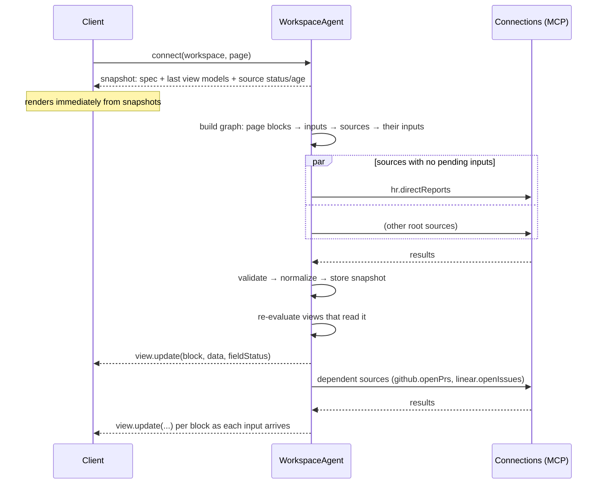

# RFC 0002: Spec format v0 — layouts, blocks, and multi-source data

| | |
|---|---|
| **Status** | Accepted — one open question (§9) |
| **Author** | Brayden Wilmoth |
| **Created** | 2026-11-06 |
| **Last updated** | 2026-11-06 (review decisions applied) |
| **Builds on** | [RFC 0001](0001-continuous-generative-ui.md), [ADR 0001](../decisions/0001-spec-is-source-of-truth.md) |

## 1. Summary

A workspace spec has three layers, each with a different job and different freedom:

| Layer | What it is | Freedom | Data |
|---|---|---|---|
| **Layout** | Freeform HTML elements styled with Tailwind, using Kumo tokens only, plus custom grid templates. Contains named **slots**. | High — custom per page and use case | None. Static text only. |
| **Blocks** | Units of UI mounted into slots: Kumo components and our composites only (no HTML). | Medium — validated against the catalog | Bound to a **view model** by path. |
| **Sources** | Workspace-level, reusable tool calls with a JSONata **normalize** step. | Low — strict contracts | Produce normalized entities with item keys and schemas. |

Blocks never call tools directly. A block declares which sources it reads (**inputs**), and a
JSONata **view expression** combines them into the block's view model. That one rule is what
makes multi-source calculations (PRs from GitHub + issues from Linear per person) reliable,
deduplicates calls across blocks, and makes reload a matter of walking a dependency graph.

## 2. Changes to RFC 0001

- **Pages and layouts are new.** A workspace has pages; each page has one layout tree with
  slots. Phase 1 uses one page. (Resolves RFC 0001 §12 Q1 in favor of pages, with a single
  page to start.)
- **Queries move from blocks to the workspace** and become **sources**, so two blocks that need
  the same data share one call, one snapshot, and one status.
- **The node format extends Kumo's `UITree`.** We keep its conventions (flat map keyed by id,
  `children` id arrays, `{ "path": … }` dynamic values, visibility conditions, actions) and add
  node kinds for HTML and slots. Kumo component props are still validated with Kumo's
  generated schemas.
- **Data mapping uses JSONata** (resolves RFC 0001 §7.3), at two points: per-source
  `normalize` and per-block `view`.

## 3. The node format

Every tree is a flat map of nodes keyed by id, plus a root id. There are two kinds of tree,
and they don't share node types:

```ts
// Page layouts: HTML structure and slots. Static text, no data, no components.
type LayoutNode =
  | { kind: "html"; tag: HtmlTag; className?: string; grid?: GridTemplate; text?: string; children?: string[] }
  | { kind: "slot"; className?: string; grid?: GridTemplate };

// Blocks: catalog components only, bound to the block's view model.
type ComponentNode = { type: CatalogType; props: Props; children?: string[];
                       visible?: VisibilityCondition; action?: Action };

// A block's tree has a body root and an optional toolbar root, rendered in the block header.
type BlockTree = { root: string; toolbar?: string; nodes: Record<string, ComponentNode> };
```

Blocks also carry persisted **UI state** (`ui`), readable at `/ui/...` and written by `set`
actions or bound inputs (e.g. a `Checkbox`). Combined with `visible` conditions, this is how
column pickers, filters, and toggles work without new component types.

**HTML in blocks** ([ADR 0005](../decisions/0005-custom-ui-with-structured-html.md)): blocks prefer
catalog components, but may also contain the same structured HTML nodes (with data bindings)
when no component fits, e.g. a banner image or a custom card. Layout HTML stays static.

- `HtmlTag` is an allowlist: `div section header footer main aside nav article h1–h4 p span
  ul ol li hr`. No `script`, `style`, `iframe`, `form`, `img` (images come later via a
  component with URL validation), and no raw attributes besides `className`.
- `CatalogType` is a Kumo component name (`Text`, `Badge`, `Button`, `LayerCard`, …) or one of
  our composites (§6).
- Ids are stable and human-readable (`team-table`, `col-open-prs`) so ops, right-click targets,
  and logs are easy to follow.

## 4. Layouts

### 4.1 Freeform, but on-brand

The layout is where the model gets to be creative: a hero strip with key numbers over a two-
column body for a team page; a three-pane triage view for incidents; a narrow reading column
for a weekly report. It's plain HTML structure plus Tailwind classes, so any arrangement is
possible, but every class must come from the **style allowlist**:

| Allowed | Examples |
|---|---|
| Layout | `flex grid grid-cols-{1..12} col-span-{1..12} gap-{0..12} items-* justify-* order-*` |
| Spacing & sizing | `p-* px-* py-* m-* mx-auto w-full max-w-{sm..7xl} min-h-* h-*` |
| Responsive & state | `sm: md: lg: xl:` prefixes on layout/spacing; `hover:` on color tokens |
| Shape | `rounded{-sm..-2xl} border border-{t,b,l,r} shadow{-sm..-lg} overflow-*` |
| Type | `text-{xs..4xl} font-{normal,medium,semibold,bold} tracking-* leading-* uppercase` |
| **Color — Kumo tokens only** | `bg-kumo-{canvas,base,elevated,recessed,tint,contrast,brand,info,success,warning,danger}`, `text-kumo-{default,strong,subtle,inactive,inverse,link,info,success,warning,danger}`, `border-kumo-{hairline,line}` |

**Not allowed:** raw Tailwind colors (`bg-blue-500`), `dark:` (Kumo tokens handle themes),
arbitrary values in `className` (`w-[317px]`; custom grids use the `grid` field, §4.4), positioning that can cover other UI (`fixed`, `absolute`,
`z-*`), and animation utilities.

### 4.2 Making runtime classes actually exist

Tailwind generates CSS only for classes it finds in source files at build time; classes that
arrive at runtime in a spec would have no CSS. So the allowlist is defined once
(`shared/spec/styles`) and used twice:

1. **Validation:** the server rejects any layout/block op whose `className` contains a token
   not on the allowlist (the model gets the error and repairs).
2. **CSS generation:** a build step emits the allowlist as a Tailwind v4 `@source inline(…)`
   safelist, so every allowed class is compiled into the stylesheet.

One list means "valid" and "styled" can never drift apart.

> **Superseded by [ADR 0006](../decisions/0006-any-tailwind-brand-policy-on-css.md):** any Tailwind class
> is allowed; brand rules are enforced on the CSS each class compiles to, and CSS is compiled on
> demand in the Worker and shipped with each change. The allowlist and safelist below are history.

### 4.3 Slots

A `slot` node marks where blocks mount. Blocks reference a slot by id and an `order`. A slot
stacks its blocks vertically by default; its `className` controls the arrangement (e.g.
`grid md:grid-cols-3 gap-4` for a row of stat cards).

```jsonc
// Team page layout (abbreviated)
{
  "root": "page",
  "nodes": {
    "page":    { "kind": "html", "tag": "div", "className": "mx-auto max-w-7xl p-6 flex flex-col gap-6", "children": ["header", "summary", "body"] },
    "header":  { "kind": "html", "tag": "header", "className": "flex flex-col gap-1", "children": ["title", "subtitle"] },
    "title":   { "kind": "html", "tag": "h1", "className": "text-2xl font-semibold text-kumo-default", "text": "My team" },
    "subtitle":{ "kind": "html", "tag": "p", "className": "text-sm text-kumo-subtle", "text": "Direct reports, their open work, and what's moving" },
    "summary": { "kind": "slot", "className": "grid grid-cols-1 md:grid-cols-3 gap-4" },
    "body":    { "kind": "html", "tag": "div", "className": "grid grid-cols-1 lg:grid-cols-3 gap-6", "children": ["main", "side"] },
    "main":    { "kind": "slot", "className": "lg:col-span-2 flex flex-col gap-6" },
    "side":    { "kind": "slot", "className": "flex flex-col gap-6" }
  }
}
```

Layouts are edited with ops too (`upsert`, `remove`, `setRoot`), and blocks can be moved between
slots or added, so "move the stats to the right side" or "put a summary next to this table" is a
layout amend, not a regeneration. A pointed edit on a block may include these page changes when
the request doesn't fit inside the block ([ADR 0004](../decisions/0004-pointed-edits.md)).

### 4.4 Custom grid templates

We're building custom software for each user, so layouts can use any grid the use case calls
for, not just equal columns. Any HTML or slot node can carry a `grid` field with track lists
per breakpoint:

```jsonc
"body": {
  "kind": "html", "tag": "div", "className": "grid grid-cols-1 gap-6",
  "grid": { "columns": { "lg": "minmax(0, 1fr) 16rem" } },   // wide table + fixed stats rail
  "children": ["main", "side"]
}
```

- Track lists are validated: numbers with `fr px rem em %`, `minmax()`, `repeat()`, `auto`,
  `min-content`, `max-content`, `fit-content`, `auto-fill`, `auto-fit`. Nothing else (no
  `calc`, `url`, or stray CSS).
- Breakpoints: `base sm md lg xl`, for `columns` and `rows`.
- **How it compiles:** Tailwind can't generate CSS for arbitrary values that arrive at
  runtime, so the renderer sets each track list as a CSS variable (`--cols-lg`) and applies a
  fixed class that reads it (`lg:grid-cols-(--cols-lg)`). Those ten classes are written
  literally in the renderer, so Tailwind always compiles them.

## 5. Sources, JSONata, and multi-source data

### 5.1 Sources

```ts
type Source = {
  id: string;                       // "github.openPrs"
  connection: string;               // connection id
  tool: string;                     // MCP tool name
  args: Record<string, Literal | { expr: string }>;  // JSONata over $inputs (other sources)
  inputs?: Record<string, string>;  // alias → source id this source depends on
  forEach?: { over: string; as: string; concurrency?: number }; // fan-out, see §5.4
  normalize: string;                // JSONata: raw tool result → normalized entities
  key?: string;                     // item key for collections (ADR 0001 §4)
  schema: JsonSchema;               // expected shape AFTER normalize (ADR 0001 §3)
  rawFingerprint?: string;          // fingerprint of the tool's declared output schema
  pagination?: { maxItems: number };// fetch pages up to this cap
  refresh: "onLoad" | "manual";     // default onLoad; see §7.1
};
```

A **normalized result** is always wrapped with metadata so downstream logic can tell "zero"
from "unknown" and "all" from "first page":

```ts
type SourceResult = {
  status: "ok" | "loading" | "stale" | "error" | "auth_required";
  data: unknown;                    // normalized, validated against `schema`
  complete: boolean;                // false if pagination cap was hit
  fetchedAt: string;
  error?: string;
};
```

There's also a **local** source kind with no tool, holding workspace-owned data. Identity maps
(§5.3) and user-entered settings are local sources, so everything a view reads is a source.

### 5.2 Block views

```ts
type Block = {
  id: string;
  slot: string; order: number;
  title?: string;
  frame: { style: "card" | "plain"; title: boolean; sources: boolean; freshness: boolean };  // chrome, all user-controllable
  inputs: Record<string, string>;   // alias → source id, e.g. { members: "hr.directReports" }
  view: { expr: string; schema: JsonSchema };   // JSONata over the inputs → view model
  fields?: Record<string, FieldMeta>;           // per computed field
  root: string; nodes: Record<string, Node>;    // the UI, bound to the view model
  templates?: Record<string, Template>;         // materialized deferred intents (RFC 0001 §8.3)
};

type FieldMeta = {
  label: string;
  definition: string;      // plain-language meaning, shown on hover: "Open PRs authored by this
                           // person, across repos you can access"
  requires: string[];      // input aliases this field depends on (drives per-field status)
};
```

The view expression is evaluated with **only the declared inputs** bound as variables
(`$members`, `$prs`, …). No hidden dependencies, so the dependency graph is always exact.

### 5.3 Identity across sources

Counting "PRs and Linear issues per team member" needs to know that HR's employee `emp_42` is
GitHub `jdoe` and Linear user `usr_9`. That mapping is a **local identity source**:

```jsonc
{ "id": "people", "kind": "local", "key": "memberId",
  "data": [ { "memberId": "emp_42", "githubLogin": "jdoe", "linearUserId": "usr_9" } ] }
```

It's built when a block first needs a cross-source join: matched automatically on a shared
field (email) where possible, otherwise proposed by the model and confirmed by the user
(ADR 0001 §5). Unmatched people stay unmatched.

### 5.4 Fan-out: batch first, `forEach` second

With 10 connections and 20 people, naive per-person calls explode. Rules for the planner:

1. **Prefer one batched call** whose args are built from inputs (e.g. one GitHub search with
   `author:a author:b …`, one Linear query with `assignee in […]`).
2. Use **`forEach`** only when the tool can't batch. It runs once per item of another source,
   with a concurrency limit, and its normalized results are concatenated.
3. The agent **dedupes** identical calls (same connection + tool + args) across sources and
   blocks, and applies **per-connection rate limits**.

### 5.5 Worked example: open PRs + open Linear issues per person

**Sources**

```jsonc
"hr.directReports": {
  "connection": "acme-hr", "tool": "list_direct_reports", "args": { "managerId": "me" },
  "normalize": "employees.{ 'id': id, 'name': full_name, 'title': job_title, 'email': work_email }",
  "key": "id"
},
"github.openPrs": {
  "connection": "github", "tool": "search_issues",
  "inputs": { "people": "people" },
  "args": { "q": { "expr": "'is:pr is:open ' & $join($people.githubLogin.('author:' & $), ' ')" } },
  "normalize": "items.{ 'id': id, 'title': title, 'url': html_url, 'author': user.login }",
  "key": "id", "pagination": { "maxItems": 500 }
},
"linear.openIssues": {
  "connection": "linear", "tool": "list_issues",
  "inputs": { "people": "people" },
  "args": { "assigneeIds": { "expr": "$people.linearUserId" }, "state": "open" },
  "normalize": "nodes.{ 'id': id, 'key': identifier, 'title': title, 'assignee': assignee.id }",
  "key": "id", "pagination": { "maxItems": 500 }
}
```

**Block view**

```jsonata
$map($members, function($m) {(
  $p := $people[memberId = $m.id];
  {
    "id": $m.id,
    "name": $m.name,
    "title": $m.title,
    "openPrs":    $p.githubLogin  ? $count($prs[author = $p.githubLogin])      : null,
    "openIssues": $p.linearUserId ? $count($issues[assignee = $p.linearUserId]) : null,
    "prsUrl":     $p.githubLogin  ? 'https://github.com/pulls?q=is:open+is:pr+author:' & $p.githubLogin : null
  }
)})
```

Inputs: `{ members: "hr.directReports", people: "people", prs: "github.openPrs",
issues: "linear.openIssues" }`. Fields `openPrs` and `openIssues` declare
`requires: ["prs", "people"]` and `["issues", "people"]`.

### 5.6 Reliability rules

These are enforced by the agent, not left to the model's judgment:

1. **Normalize before combining.** Views only ever see normalized, schema-validated data, never
   raw provider responses.
2. **Unknown is not zero.** An unmatched identity or a failed source yields `null`, which
   renders as "—" with an explanation, never `0`.
3. **Partial, not all-or-nothing.** If Linear fails, the view is still evaluated with
   `issues = null`; the PR column renders and only the issues cells show an error state, via
   `requires`.
4. **Incomplete is visible.** If a source hit its pagination cap (`complete: false`), counts
   derived from it render as "50+" style lower bounds.
5. **Dry-run at generation time.** Before a source or view is committed, the agent runs it
   against live data, validates the output against its schema, and checks for suspicious
   results (a column that's entirely `null` or `0`, an empty join). Failures go back to the
   model for repair, or become a clarifying question.
6. **Saved fixtures.** The input sample and output from the dry run are stored with the
   expression, so later edits can be regression-checked without calling tools.
7. **Bounded evaluation.** JSONata runs with a time budget and input size limit; an expression
   that exceeds them is rejected.
8. **Definitions are shown.** Every computed field carries a plain-language `definition`, so a
   number is never ambiguous ("open PRs" — authored? reviewing? which repos?).

Where it runs: sources and views are evaluated in the **workspace agent**, and the client
receives view models. The evaluation code is a pure module in `shared/` so it can also run
client-side later (e.g. WebMCP sources, or views over local UI state).

## 6. Composites

Composites wrap common patterns into single catalog entries with data-aware behavior. They're
added as patterns recur during build and test, not designed up front. Each one is a folder:

```
src/features/renderer/composites/<Name>/
  schema.ts     zod props schema + description (feeds validation and the model's catalog prompt)
  <Name>.tsx    React implementation using Kumo components
  index.ts      registers { type, schema, component }
```

A first pass of this pattern is implemented in `src/features/renderer/` and rendered by the
`team` fixture in `src/features/preview/` (with simulated reload enrichment).

Composites receive resolved props, the render context (view model, `$item` scope, input
status), and a `renderNode(id, scope?)` function for child nodes. Implemented so far:

| Composite | Pattern | Notes |
|---|---|---|
| `DataTable` + `DataColumn` | Table over an array in the view model | Columns are **child nodes**, so "add a PR column" is one `node.upsert` and right-clicking a column targets its id. Columns show a `field` (with optional `subField` second line, e.g. title under name) and a format, or render component children with `$item` scope. Per-cell loading/error from `requires`. Optional row selection (`selectionBind`: a `/ui/...` list of row keys, with select-all) that other components can read for bulk actions. |
| `Stat` | A labelled number with optional hint | Handles `null` ("—"), lower bounds ("50+"), and formats. |
| `ActionMenu` + `MenuItem` | The `⋯` row menu | Flattens Kumo's compound `DropdownMenu`; each `MenuItem` carries an action, usually a deferred intent. |

Kumo primitives are exposed through thin catalog wrappers with data-friendly props: `Text`
(with `format`, e.g. `count`, and `prefix`/`suffix`), `Badge`, and `Button` (which fires its
node's `action`). Layout and input primitives: `Stack`, `Popover`, and `Checkbox` (bound to UI
state as a flag, or as membership of a `value` in a list for per-item checkboxes).

## 7. Reload and enrichment

On page load (ADR 0001 §6, made concrete):



- **What's linked to what is always known:** the spec gives `block → inputs → sources →
  connection`. The agent keeps the reverse index (`source → blocks`) to know what to
  re-evaluate when a result arrives.
- **Progressive:** views are re-evaluated as each input arrives, so the UI enriches column by
  column instead of waiting for the slowest source.
- **Scoped:** only sources used by blocks on the current page run on load; unused sources are
  garbage-collected.
- **Auth problems are local:** a source returning `auth_required` puts a "Reconnect GitHub"
  banner on the affected blocks only.
- **Provenance in the UI:** each block shows the connections it draws from and when its data
  was last updated, so users can see where every number came from.

### 7.1 Refresh

Sources run **on load only**. There are no default intervals. If a user wants fresher data,
they ask for it, and that becomes UI like anything else:

- "Add a refresh button" → the planner adds a `Button` block (e.g. into a header slot) with
  `action: { name: "refresh", params: { page: "team" } }`. Params can target a page or a
  `block`; the agent re-runs the sources those blocks read, through the same graph as reload.
- "Keep the PR column live" → later, a source-level policy the agent manages (e.g. a
  scheduled refresh). Not in v0; it would be added as an explicit, visible setting.

## 8. Code layout

```
shared/spec/          zod schemas: nodes, layout, block, source, workspace, style allowlist
shared/data/          JSONata evaluation, graph building, result wrappers (pure, no I/O)
src/features/renderer/
  components/         PageRenderer, NodeRenderer, BlockFrame
  composites/         DataTable, Stat, ActionMenu, …
  lib/                value resolution, formatting
worker/agent/         WorkspaceAgent: sources, evaluation, ops, sync
```

## 9. Review decisions (2026-11-06)

| # | Question | Decision |
|---|---|---|
| 1 | Layout freedom / custom grids | **Allowed.** Layouts can be as custom as the use case calls for; custom grids via the validated `grid` field (§4.4). |
| 2 | HTML inside blocks | ~~Layouts only~~ **Superseded by [ADR 0005](../decisions/0005-custom-ui-with-structured-html.md):** structured HTML is allowed in blocks too, for custom UI the catalog lacks. |
| 3 | Identity map scope (workspace vs. page) | **Open.** The fixture uses one workspace-level `people` source; nothing else depends on the choice yet. |
| 4 | Where views evaluate | **Server.** The workspace agent computes view models; clients render what it sends. |
| 5 | Refresh defaults | **On load only.** More frequent refresh is user-requested UI, e.g. a refresh button with a `refresh` action (§7.1). |
